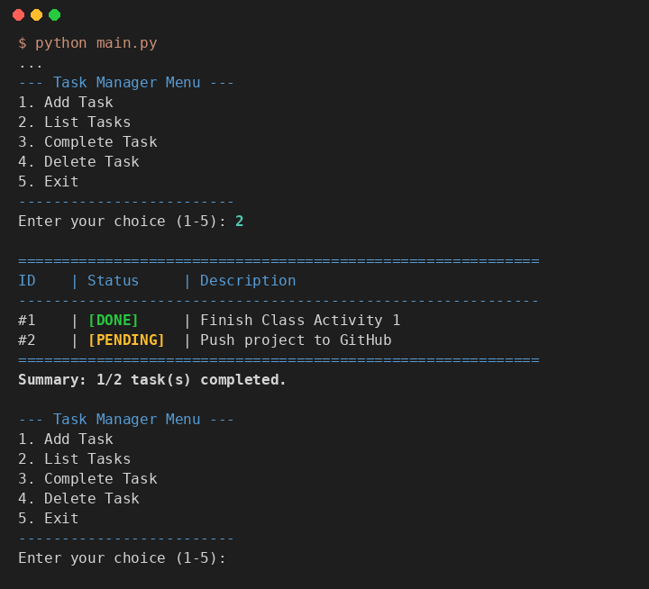

# Class Activity 1: Building a Simple CLI Application

**ชื่อ:** สาริษฐ์ บุตรช่วง  **รหัสนักศึกษา:** 663380365-3
**รายวิชา:** CP352301 Script Programming (1/2569) — Week 7

โปรแกรม Task Manager แบบ command line สำหรับเพิ่ม แสดง ทำเครื่องหมายเสร็จ และลบงาน บันทึกข้อมูลลง `data/tasks.json` อัตโนมัติ และจัดการ input ผิดด้วย `try-except` โดยโปรแกรมไม่ crash

## ผลการรัน — เมนู 2. List Tasks

มีงานที่ทำเสร็จแล้ว `[DONE]` 1 งาน และงานที่ยังไม่เสร็จ `[PENDING]` 1 งาน



ผลการรันทุกเมนูแบบเต็ม (เพิ่มงาน, ใส่ข้อความว่าง, complete, ใส่ ID เป็นตัวอักษร, ลบ ID ที่ไม่มี, เลือกเมนูผิด) อยู่ใน [screenshots/demo_output.txt](screenshots/demo_output.txt)

## ฟีเจอร์

| เมนู | การทำงาน |
|---|---|
| 1. Add Task | เพิ่มงานใหม่ ได้ ID อัตโนมัติ (ID มากสุด + 1) ไม่รับ description ว่าง |
| 2. List Tasks | แสดงตาราง ID / สถานะ `[DONE]` `[PENDING]` / รายละเอียด พร้อมสรุปจำนวนงานที่เสร็จ |
| 3. Complete Task | ทำเครื่องหมายว่าเสร็จตาม ID แจ้งเตือนถ้าเสร็จไปแล้วหรือไม่พบ ID |
| 4. Delete Task | ลบงานตาม ID แจ้งเตือนถ้าไม่พบ ID |
| 5. Exit | บันทึกแล้วออกจากโปรแกรม |

## Error handling

| กรณี | วิธีจัดการ |
|---|---|
| ใส่ ID เป็นตัวอักษร เช่น `abc` | `try: int(...)` / `except ValueError` แจ้งให้ใส่ตัวเลข |
| ไม่มีไฟล์ `tasks.json` (รันครั้งแรก) | `except FileNotFoundError` เริ่มจากลิสต์ว่าง |
| ไฟล์ `tasks.json` เสีย | `except json.JSONDecodeError` แจ้งเตือนแล้วเริ่มจากลิสต์ว่าง |
| เขียนไฟล์ไม่ได้ | `except OSError` แจ้ง error แทนการ crash |
| เลือกเมนูที่ไม่มี / description ว่าง | แจ้งเตือนแล้ววนกลับไปที่เมนู |
| กด Ctrl+C | ออกจากโปรแกรมอย่างเรียบร้อย (ข้อมูลถูกบันทึกทุกครั้งที่มีการเปลี่ยนแปลงอยู่แล้ว) |

## วิธีรัน

ต้องใช้ Python 3 ไม่ต้องติดตั้งไลบรารีเพิ่ม

```bash
cd "Class Activity/Week07 - Class Activity 1"
python main.py
```

ใน VS Code: เปิดโฟลเดอร์นี้ แล้วเปิด `main.py` กดปุ่ม Run Python File

## โครงสร้างไฟล์

```
Week07 - Class Activity 1/
├── src/
│   ├── __init__.py      ทำให้ src เป็น Python package
│   ├── task_data.py     โหลด/บันทึก tasks.json (persistence)
│   └── task_logic.py    logic หลัก: add, list, complete, delete
├── data/
│   └── tasks.json       ข้อมูลงาน (สร้าง/อัปเดตอัตโนมัติ)
├── screenshots/         ผลการรัน
├── main.py              จุดเริ่มโปรแกรม: เมนูและรับ input
├── .gitignore
└── README.md
```

ข้อมูลแต่ละงานเก็บเป็น dictionary ใน list:

```python
tasks = [{"id": 1, "description": "Finish Class Activity 1", "completed": True}]
```

## สิ่งที่ปรับจากโค้ดตัวอย่าง

- `main.py` import ผ่าน package (`from src import task_data, task_logic`) แทนการแก้ `sys.path`
- บันทึกไฟล์ทุกครั้งที่ข้อมูลเปลี่ยน ไม่ใช่เฉพาะตอนเลือก Exit ข้อมูลจึงไม่หายถ้าปิดโปรแกรมกลางคัน
- เมนู List แสดงเป็นตารางพร้อมสถานะ `[DONE]` / `[PENDING]` และสรุปจำนวนงานที่เสร็จ
- `.gitignore` ตัวอย่างเขียน comment ต่อท้าย pattern บรรทัดเดียวกัน ซึ่ง git ไม่รองรับ จึงแยกบรรทัด
