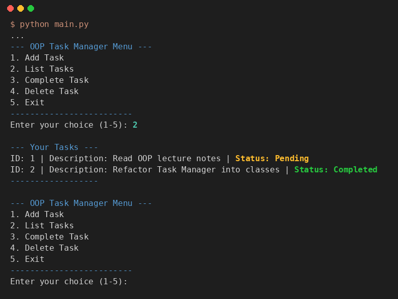

# Class Activity 2: OOP Fundamentals & Refactoring the CLI Task Manager

**ชื่อ:** สาริษฐ์ บุตรช่วง  **รหัสนักศึกษา:** 663380365-3
**รายวิชา:** CP352301 Script Programming (1/2569) — Week 8

นำ Task Manager จาก [Class Activity 1](../Week07%20-%20Class%20Activity%201) มาเขียนใหม่แบบ **Object-Oriented Programming** โดยเปลี่ยนจาก dictionary + ฟังก์ชันแยก ๆ เป็น class `Task` (งาน 1 ชิ้น) และ class `TaskManager` (จัดการรายการงานทั้งหมดและการบันทึกไฟล์)

## ผลการรัน — เมนู 2. List Tasks

มีงาน `Pending` 1 งาน และ `Completed` 1 งาน



ผลการรันแบบเต็ม (เพิ่มงาน, complete, complete ซ้ำ, ใส่ ID เป็นตัวอักษร, ลบ ID ที่ไม่มี) อยู่ใน [screenshots/demo_output.txt](screenshots/demo_output.txt)

## OOP Design

### `Task` — [src/task.py](src/task.py)

| ส่วน | หน้าที่ |
|---|---|
| Attributes | `id`, `description`, `completed` (กำหนดใน `__init__` ผ่าน `self`) |
| `__init__(self, id, description, completed=False)` | constructor สร้าง object พร้อมค่าเริ่มต้น |
| `mark_complete(self)` | เปลี่ยน `self.completed` เป็น `True` |
| `to_dict(self)` | แปลง object เป็น dict เพื่อบันทึก JSON |
| `from_dict(cls, data)` | (classmethod) สร้าง object กลับจาก dict ที่โหลดจาก JSON |
| `__str__` | ข้อความสำหรับผู้ใช้ เรียกอัตโนมัติตอน `print(task)` |
| `__repr__` | ข้อความสำหรับ debug เช่น `Task(id=1, description='...', completed=False)` |

### `TaskManager` — [src/task_manager.py](src/task_manager.py)

| ส่วน | หน้าที่ |
|---|---|
| Attributes | `self.tasks` (list ของ `Task`), `self.next_id`, `self.data_file` |
| `_load_tasks()` / `_save_tasks()` | (internal) โหลด JSON แล้วแปลงเป็น `Task` / แปลง `Task` เป็น dict แล้วบันทึก |
| `add_task(description)` | สร้าง `Task` ใหม่ เพิ่มเข้า list แล้วบันทึก |
| `list_tasks()` | แสดงงานทั้งหมดด้วย `print(task)` |
| `complete_task(task_id)` | หางานตาม ID แล้วเรียก `task.mark_complete()` |
| `delete_task(task_id)` | ลบงานตาม ID แล้วบันทึก |

`main.py` ทำหน้าที่แค่แสดงเมนูและรับ input แล้วส่งต่อให้ object `manager = TaskManager()` ข้อมูลและการทำงานทั้งหมดจึงอยู่รวมกันใน class (encapsulation)

### เปรียบเทียบกับ Activity 1

| Activity 1 (Procedural) | Activity 2 (OOP) |
|---|---|
| งาน = `{"id": 1, "description": ..., "completed": False}` | งาน = `Task(1, "...")` |
| `task["completed"] = True` | `task.mark_complete()` |
| ส่ง `tasks` เข้าไปทุกฟังก์ชัน `add_task(tasks, ...)` | `manager.add_task(...)` — object เก็บ `tasks` ไว้เอง |
| แยกไฟล์ `task_data.py` / `task_logic.py` | `TaskManager` รวมข้อมูล + การทำงาน + การบันทึก |

## วิธีรัน

```bash
cd "Class Activity/Week08 - Class Activity 2"
python main.py
```

## โครงสร้างไฟล์

```
Week08 - Class Activity 2/
├── src/
│   ├── __init__.py       ทำให้ src เป็น Python package
│   ├── task.py           class Task
│   └── task_manager.py   class TaskManager
├── data/tasks.json       ข้อมูลงาน (Pending 1 + Completed 1)
├── screenshots/          ผลการรัน
├── main.py               เมนูและรับ input
├── .gitignore
└── README.md
```

## สิ่งที่ปรับจากโค้ดตัวอย่าง

- **แก้ ImportError**: `main.py` ตัวอย่างเพิ่ม `src` เข้า `sys.path` แล้ว `from task_manager import TaskManager` แต่ `task_manager.py` ใช้ `from .task import Task` (relative import) จึงรันไม่ได้ (`attempted relative import with no known parent package`) แก้เป็น `from src.task_manager import TaskManager`
- เพิ่ม `Task.from_dict()` ให้การแปลง dict กลับเป็น object อยู่ใน class `Task` เอง และข้ามรายการที่ข้อมูลไม่ครบแทนที่จะ crash
- `delete_task` แจ้ง error ถ้าไม่พบ ID โดยไม่สร้าง list ใหม่ทั้งก้อน
