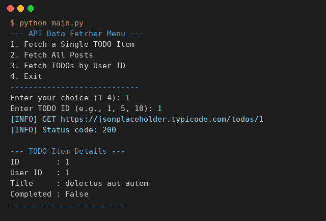
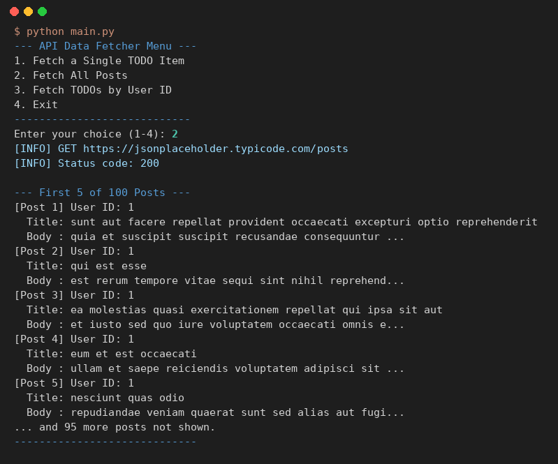
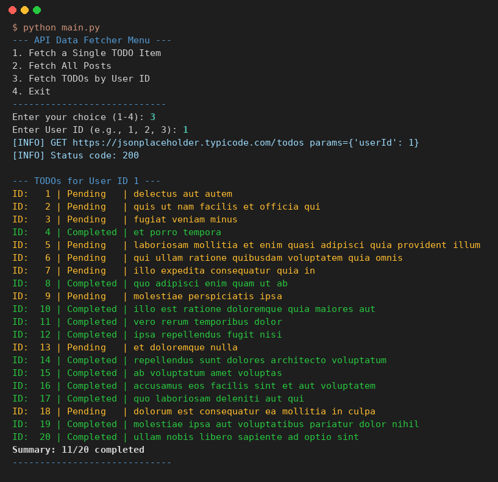

# Class Activity 3: Interacting with Web APIs — Fetching and Processing JSON Data

**ชื่อ:** สาริษฐ์ บุตรช่วง  **รหัสนักศึกษา:** 663380365-3
**รายวิชา:** CP352301 Script Programming (1/2569) — Week 10

โปรแกรม CLI ที่ใช้ไลบรารี `requests` ส่ง HTTP GET ไปยัง [JSONPlaceholder](https://jsonplaceholder.typicode.com/) (fake REST API สำหรับทดสอบ) แปลง JSON ที่ได้เป็น dict / list ของ Python แล้วแสดงผลให้อ่านง่าย พร้อมจัดการ error ด้าน network และ response

## ผลการรัน

ข้อมูลในภาพเป็นข้อมูลจริงจาก JSONPlaceholder (status 200) ข้อความเต็มอยู่ใน [screenshots/demo_output.txt](screenshots/demo_output.txt)

**1. Fetch a Single TODO Item** (TODO ID = 1)



**2. Fetch All Posts** (แสดง 5 รายการแรกจากทั้งหมด 100)



**3. Fetch TODOs by User ID** (User ID = 1)



## เมนูและ Endpoint ที่ใช้

| เมนู | Endpoint | ผลลัพธ์ (JSON → Python) | สิ่งที่แสดง |
|---|---|---|---|
| 1. Fetch a Single TODO Item | `GET /todos/{id}` | `dict` | ID, User ID, Title, Completed |
| 2. Fetch All Posts | `GET /posts` | `list` ของ 100 `dict` | 5 โพสต์แรก (title + body ย่อ 50 ตัวอักษร) และจำนวนที่เหลือ |
| 3. Fetch TODOs by User ID | `GET /todos?userId={id}` | `list` ของ `dict` | ทุก TODO ของ user พร้อมสถานะ Completed/Pending และสรุปจำนวนที่เสร็จ |
| 4. Exit | — | — | ออกจากโปรแกรม |

## Error handling

| กรณี | Exception / การตรวจ | ข้อความที่แสดง |
|---|---|---|
| ID ไม่มีอยู่ เช่น `/todos/999` | `raise_for_status()` → `HTTPError` (404) | Error 404: Not found |
| Server error 5xx | `HTTPError` | HTTP Error: ... |
| ไม่มีอินเทอร์เน็ต / เชื่อมต่อไม่ได้ | `ConnectionError` | Connection Error: could not reach the server |
| Server ตอบช้าเกิน 10 วินาที | `Timeout` | Timeout Error |
| Response ไม่ใช่ JSON | `requests.exceptions.JSONDecodeError` | the server response was not valid JSON |
| พิมพ์ ID เป็นตัวอักษรหรือเลข ≤ 0 | `ValueError` / ตรวจค่า | ให้ใส่จำนวนเต็มบวก |
| User ID ที่ไม่มี TODO (เช่น 50) | list ว่าง `[]` | No TODOs found for this user |

## วิธีรัน

```bash
cd "Class Activity/Week10 - Class Activity 3"
pip install -r requirements.txt
python main.py
```

ทดสอบ `APIClient` โดยไม่ต้องต่ออินเทอร์เน็ต (ใช้ `unittest.mock` จำลอง `requests.get`) — 8 test ครอบคลุมกรณีสำเร็จ, 404, 500, connection error, timeout และ JSON เสีย:

```bash
python -m unittest discover tests -v
```

## โครงสร้างไฟล์

```
Week10 - Class Activity 3/
├── src/
│   ├── __init__.py        ทำให้ src เป็น Python package
│   └── api_client.py      class APIClient: ส่ง request + จัดการ error
├── tests/
│   └── test_api_client.py unit test (mock requests.get)
├── screenshots/           ภาพผลการรัน
├── main.py                เมนู CLI และแสดงผลข้อมูล
├── requirements.txt       requests
├── .gitignore
└── README.md
```

## สิ่งที่ปรับจากโค้ดตัวอย่าง

- **แก้ import**: `main.py` ใช้ `from src.api_client import APIClient` แทนการแก้ `sys.path`
- **JSON error**: ตัวอย่างดัก `json.JSONDecodeError` ไว้หลัง `RequestException` แต่ `response.json()` ของ requests รุ่นใหม่โยน `requests.exceptions.JSONDecodeError` ซึ่งเป็น subclass ของ `RequestException` จึงไม่เคยเข้าบล็อกนั้น แก้โดยดัก `requests.exceptions.JSONDecodeError` ก่อน
- **เมนู 3**: ตัวอย่างเช็ก `if user_todos:` ก่อน ทำให้ข้อความ "No TODOs found" ไม่มีทางแสดง (list ว่างถูกมองว่า False) แก้ให้แยก "เรียก API ไม่สำเร็จ" (`None`) กับ "สำเร็จแต่ไม่มีข้อมูล" (`[]`)
- ส่ง `userId` ผ่าน `params=` ของ `requests.get` แทนการต่อ string ใน URL
- แสดง status code ของทุก request และสรุปจำนวน TODO ที่เสร็จในเมนู 3
