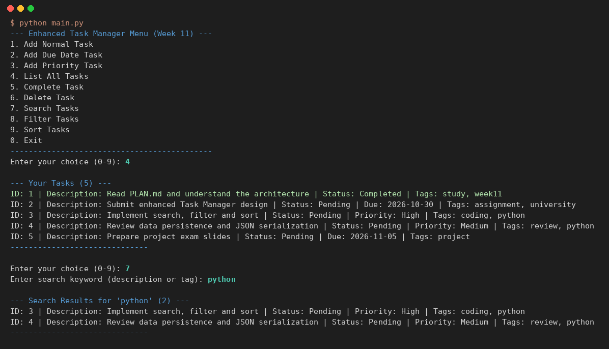
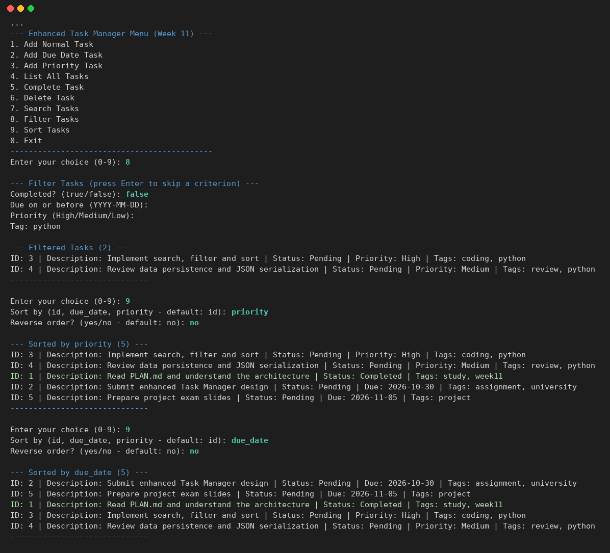

# Class Activity 4: Project Planning & Design — Building an Enhanced Task Manager

**ชื่อ:** สาริษฐ์ บุตรช่วง  **รหัสนักศึกษา:** 663380365-3
**รายวิชา:** CP352301 Script Programming (1/2569) — Week 11

ออกแบบ Task Manager เวอร์ชันใหม่ก่อนลงมือเขียน โดยแยกโค้ดเป็นชั้น (UI / business logic / data) และเพิ่มฟีเจอร์ **tags, search, filter, sort** รายละเอียดการวางแผนและออกแบบทั้งหมดอยู่ใน **[PLAN.md](PLAN.md)** (requirements, architecture diagram, class diagram, pseudocode, implementation plan)

## ผลการรัน

**4. List All Tasks และ 7. Search Tasks** (ค้นคำว่า `python` ใน description และ tags)



**8. Filter Tasks** (งานที่ยังไม่เสร็จ + มี tag `python`) และ **9. Sort Tasks** (ตาม priority และ due_date)



ผลการรันแบบเต็ม (รวมการเพิ่มงานที่ใส่วันที่ผิดก่อน และใส่ ID เป็นตัวอักษร) อยู่ใน [screenshots/demo_output.txt](screenshots/demo_output.txt)

## สถาปัตยกรรม

| โมดูล | หน้าที่ |
|---|---|
| [`src/task.py`](src/task.py) | Models: `Task`, `DueDateTask`, `PriorityTask` (มี `tags`) |
| [`src/data_persistence.py`](src/data_persistence.py) | อ่าน/เขียน `data/tasks.json` และสร้าง object กลับตาม `_type` |
| [`src/task_manager.py`](src/task_manager.py) | Business logic: add, complete, delete, **search, filter, sort** |
| [`src/cli_interface.py`](src/cli_interface.py) | เมนู, รับและตรวจ input, แสดงผล |
| [`main.py`](main.py) | สร้าง `TaskManager` + `CLIInterface` แล้วเริ่มโปรแกรม |

## ฟีเจอร์ใหม่ (Assignment)

| เมนู | การทำงาน |
|---|---|
| 7. Search | หาคำใน description หรือ tags ไม่สนตัวพิมพ์เล็ก/ใหญ่ |
| 8. Filter | สถานะ (true/false), ครบกำหนดก่อนวันที่, priority, tag — ใส่หลายเงื่อนไขพร้อมกันได้ (AND) กด Enter เพื่อข้าม |
| 9. Sort | `id`, `due_date`, `priority` (High → Medium → Low) งานที่ไม่มีวันที่/priority อยู่ท้าย เลือกกลับลำดับได้ |

## วิธีรัน

```bash
cd "Class Activity/Week11 - Class Activity 4"
python main.py
```

ใน `data/tasks.json` มีงานตัวอย่าง 5 งาน (ครบทั้ง 3 ประเภท) ไว้ลอง search / filter / sort

## โครงสร้างไฟล์

```
Week11 - Class Activity 4/
├── src/
│   ├── __init__.py
│   ├── task.py
│   ├── data_persistence.py
│   ├── task_manager.py
│   └── cli_interface.py
├── data/tasks.json
├── screenshots/
├── main.py
├── PLAN.md          เอกสารวางแผนและออกแบบ
├── README.md
└── .gitignore
```

## สิ่งที่ปรับจากโค้ดตัวอย่าง

- **แก้ ImportError:** `main.py` ตัวอย่างใช้ `sys.path.append('src')` + `from task_manager import TaskManager` แต่ `task_manager.py` ใช้ relative import จึงรันไม่ได้ → เปลี่ยนเป็น `from src.task_manager import TaskManager`
- **ทำ search / filter / sort ให้ใช้งานได้จริง** (ในตัวอย่างเป็น placeholder ที่พิมพ์ `DEBUG: ... not yet implemented`)
- `__str__` ของ subclass ใช้ method `details()` แทนการ `split(' | Tags:')` ข้อความ
- `PriorityTask` ตรวจค่า priority ใน constructor, `tags` คัดลอกเป็น list ใหม่ (ไม่ใช้ list เดียวกันร่วมกันหลาย object)
- โหลด JSON แล้วข้ามงานที่ข้อมูลผิดทีละรายการแทนที่จะทิ้งทั้งไฟล์
