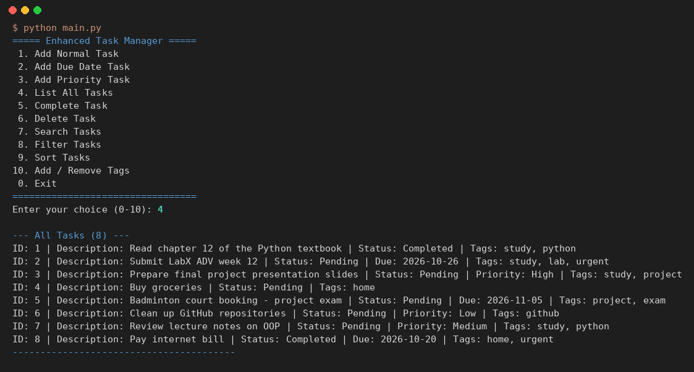
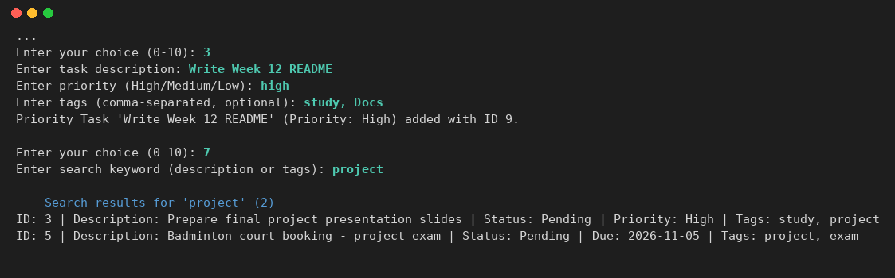
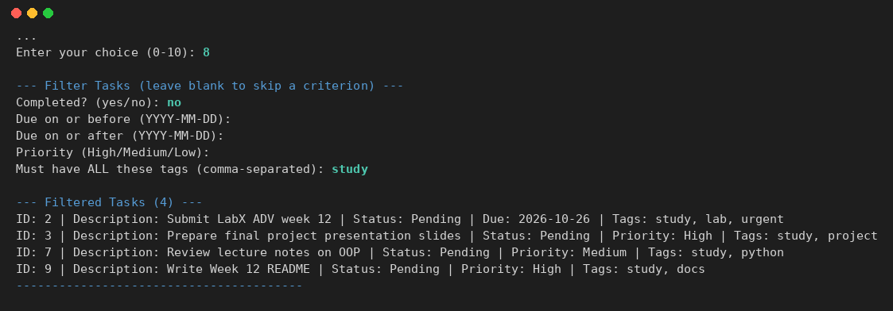
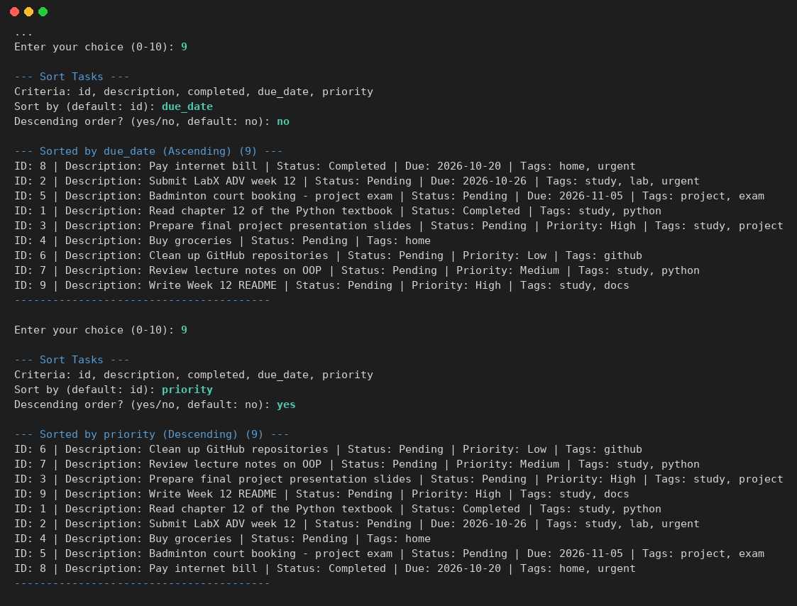
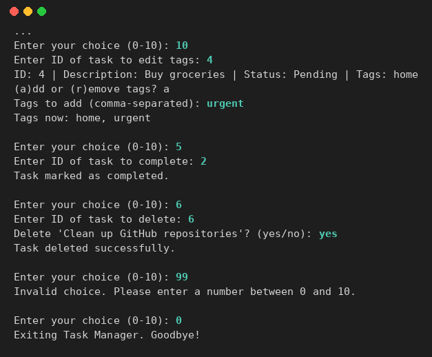

# Lab Week 12: Final Project Development — Enhanced Task Manager CLI

**ชื่อ:** สาริษฐ์ บุตรช่วง  **รหัสนักศึกษา:** 663380365-3
**รายวิชา:** SP352301 Script Programming (1/2569)

โปรแกรมจัดการงาน (Task Manager) แบบ command line ที่ต่อยอดจากแผนใน Week 11 รวมทุกเรื่องที่เรียนมา ได้แก่ OOP (inheritance / polymorphism), แยกโมดูล, บันทึกข้อมูลเป็น JSON, `datetime`, error handling และ `logging` พร้อมฟีเจอร์ใหม่คือ **tags, search, filter และ sort**

## ฟีเจอร์

| ฟีเจอร์ | รายละเอียด |
|---|---|
| ประเภทงาน 3 แบบ | `Task` (ทั่วไป), `DueDateTask` (มีวันกำหนดส่ง), `PriorityTask` (High / Medium / Low) |
| Tags | ใส่ได้หลาย tag ต่องาน ปรับเป็นตัวพิมพ์เล็กและไม่ซ้ำอัตโนมัติ เพิ่ม/ลบภายหลังได้ (เมนู 10) |
| CRUD | เพิ่ม, แสดงทั้งหมด, ทำเครื่องหมายว่าเสร็จ, ลบ (มีถามยืนยันก่อนลบ) |
| Search | ค้นหาคำใน description และ tags แบบไม่สนตัวพิมพ์เล็ก/ใหญ่ และจับคำบางส่วนได้ |
| Filter | รวมหลายเงื่อนไขพร้อมกัน (AND): สถานะเสร็จ/ยังไม่เสร็จ, ช่วงวันที่ก่อน/หลัง, ระดับ priority, ต้องมี tag ครบทุกตัวที่ระบุ |
| Sort | ตาม id, description, completed, due_date, priority — งานที่ไม่มีวันที่/priority อยู่ท้ายเสมอ และงานที่ค่าเท่ากันเรียงตาม id |
| Data persistence | บันทึก `data/tasks.json` อัตโนมัติทุกครั้งที่แก้ไข โหลดกลับมาเป็น class ที่ถูกต้องผ่าน field `_type` |
| Error handling | ตรวจรูปแบบวันที่, priority, ID ที่ไม่ใช่ตัวเลข, เมนูที่ไม่มี, ไฟล์ JSON เสีย, งานเก่าที่ยังไม่มี `tags` |
| Logging | รัน `python main.py --debug` เพื่อดู log การโหลด/บันทึก/เพิ่มงาน แทนการใส่ `print` ทั่วโค้ด |

## วิธีรัน

ต้องใช้ Python 3.8 ขึ้นไป ไม่ต้องติดตั้งไลบรารีเพิ่ม

```bash
cd "Lab/Week12"
python main.py            # เริ่มโปรแกรม (มีงานตัวอย่าง 8 งานใน data/tasks.json สำหรับ demo)
python main.py --debug    # แสดง log ระหว่างทำงาน
python -m unittest discover tests -v   # รัน unit test 13 ข้อ
```

## เมนู

```
===== Enhanced Task Manager =====
 1. Add Normal Task        6. Delete Task
 2. Add Due Date Task      7. Search Tasks
 3. Add Priority Task      8. Filter Tasks
 4. List All Tasks         9. Sort Tasks
 5. Complete Task         10. Add / Remove Tags
 0. Exit
```

## ผลการรัน

ภาพด้านล่างสร้างจากผลรันจริงของโปรแกรม (ข้อความเต็มอยู่ใน [screenshots/demo_output.txt](screenshots/demo_output.txt))

**แสดงงานทั้งหมด**


**เพิ่มงาน Priority พร้อม tags และค้นหาคำว่า `project`**


**Filter: งานที่ยังไม่เสร็จ และมี tag `study`**


**Sort ตาม due_date (น้อยไปมาก) และ priority (มากไปน้อย)**


**เพิ่ม tag, ทำงานให้เสร็จ, ลบงาน และใส่เมนูผิด**


## โครงสร้างไฟล์

```
Week12/
├── src/
│   ├── __init__.py          ทำให้ src เป็น package
│   ├── task.py              Task, DueDateTask, PriorityTask (มี tags)
│   ├── data_persistence.py  โหลด/บันทึก JSON
│   ├── task_manager.py      business logic: CRUD, tags, search, filter, sort
│   └── cli_interface.py     เมนูและการรับ/แสดงผล
├── data/tasks.json          งานตัวอย่างสำหรับ demo
├── tests/test_task_manager.py   unit test 13 ข้อ (ใช้ไฟล์ชั่วคราว ไม่แตะ data/tasks.json)
├── screenshots/             ผลการรัน
├── main.py                  จุดเริ่มโปรแกรม
├── PLAN.md                  แผนงาน รายละเอียดการทำ และสิ่งที่ได้เรียนรู้
└── .gitignore
```

## สิ่งที่ปรับจากโค้ดตัวอย่าง (Prototype)

- **แก้ ImportError**: `main.py` ตัวอย่างเพิ่ม `src` เข้า `sys.path` แล้ว `from task_manager import ...` แต่ `task_manager.py` ใช้ relative import (`from .task import ...`) ทำให้รันไม่ได้ จึงเปลี่ยนเป็น `from src.task_manager import TaskManager`
- **Sort**: ตัวอย่างใช้ `datetime.date.max` / ค่า 99 ทำให้ตอน `reverse=True` งานที่ไม่มีวันที่/priority ขึ้นไปอยู่บนสุด จึงแยกงานเหล่านี้ไว้ท้ายเสมอ และให้งานที่ค่าเท่ากันเรียงตาม id
- **Tags**: normalize ตั้งแต่ใน constructor จึงไม่มี tag ซ้ำหรือตัวพิมพ์ใหญ่ แม้โหลดจาก JSON
- **โหลด JSON**: ข้ามงานที่ข้อมูลผิดทีละรายการแทนที่จะทิ้งทั้งไฟล์
- **.gitignore**: ตัวอย่างเขียน comment ต่อท้าย pattern บรรทัดเดียวกัน ซึ่ง git ไม่รองรับ จึงแยกบรรทัด
- **CLI**: เพิ่มเมนู 10 (add/remove tags), ยืนยันก่อนลบ, กด Ctrl+C แล้วออกอย่างเรียบร้อย
- **เพิ่ม unit test** ครอบคลุม model, persistence, CRUD, search, filter, sort และ edge case (ลิสต์ว่าง, ข้อมูลผิด)

## สิ่งที่จะพัฒนาต่อ

GUI (Tkinter), เปลี่ยนไปใช้ SQLite, แจ้งเตือนงานใกล้ครบกำหนดตอนเปิดโปรแกรม, งานที่ทำซ้ำ (recurring), export เป็น CSV, เว็บด้วย Flask
